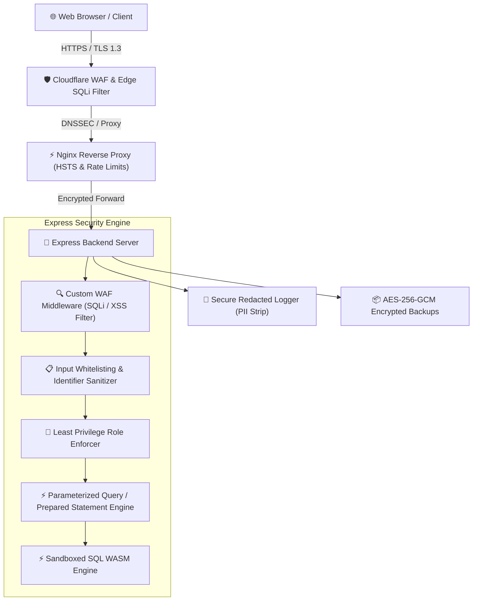

# Enterprise Security Hardening & SQL Injection Defense Specification

> [!IMPORTANT]
> This security specification covers end-to-end implementation details for all 15 core cybersecurity requirements as well as strict SQL Injection (SQLi) defense protocols in the **SQL Practice Playground** application stack.

---

## 🏗️ Architectural Overview & Threat Defense Model



---

## 🛡️ Key SQL Injection (SQLi) Defense Directives

### 1. Prepared Statements (Parameterized Queries)
* **Principle**: Separates SQL code logic from data inputs, ensuring user inputs are treated strictly as literals.
* **Implementation**: Implemented in [`server/utils/sqlSecurity.js`](file:///g:/SQL-PLAYGROUND/hospital_db_sql/server/utils/sqlSecurity.js) using SQLite prepared statement binding (`db.prepare(sql).bind(params)`).
```javascript
// Safe Parameterized Query Execution
const stmt = db.prepare('SELECT * FROM employees WHERE department_id = ? AND salary >= ?');
stmt.bind([departmentId, minSalary]);
```

### 2. Input Validation & Whitelisting
* **Principle**: Dynamic table names, column names, and sorting options cannot be parameterized in standard SQL. They must be validated against a strict whitelist.
* **Implementation**: [`server/utils/sqlSecurity.js`](file:///g:/SQL-PLAYGROUND/hospital_db_sql/server/utils/sqlSecurity.js) enforces strict identifier regex (`/^[a-zA-Z0-9_]+$/`) and table name whitelisting (`['employees', 'departments', 'doctors', 'patients']`).

### 3. Principle of Least Privilege
* **Principle**: Restrict database user role privileges so application users cannot execute schema destruction (`DROP TABLE`, `ALTER TABLE`) or access system directives.
* **Implementation**: [`server/utils/sqlSecurity.js`](file:///g:/SQL-PLAYGROUND/hospital_db_sql/server/utils/sqlSecurity.js) defines execution role matrices:
  * `READ_ONLY`: Restricted strictly to `SELECT` and `WITH` statements.
  * `APP_USER`: Permitted `SELECT`, `INSERT`, `UPDATE`. Blocks `DROP`, `ALTER`, `PRAGMA`.

### 4. Web Application Firewall (WAF) SQLi Signatures
* **Principle**: Inspect network edge HTTP payloads for malicious patterns before they reach server application logic.
* **Implementation**: [`server/middleware/security.js`](file:///g:/SQL-PLAYGROUND/hospital_db_sql/server/middleware/security.js) and [`server/utils/sqlSecurity.js`](file:///g:/SQL-PLAYGROUND/hospital_db_sql/server/utils/sqlSecurity.js) scan for `UNION SELECT`, stacked queries (`; DROP`), boolean blind injection (`OR 1=1`), time delays (`SLEEP()`), and inline MySQL comments (`/*...*/`).

### 5. Stored Procedures & Abstract Views
* **Principle**: Encapsulate complex relational queries behind virtual view interfaces to isolate base table structures and enforce parameter inputs.
* **Implementation**: Helper function `createAbstractViewProcedure()` dynamically registers view definitions in the WASM database engine.

---

## 📋 Comprehensive Summary of Implemented Security Directives

| # | Security Control | Implementation Details & Status | Verified in Code |
|---|---|---|---|
| **1** | **SSL/TLS Certificates** | TLS 1.3 enforcement, HTTPS redirect middleware, Nginx reverse proxy configuration. | [`server/middleware/security.js`](file:///g:/SQL-PLAYGROUND/hospital_db_sql/server/middleware/security.js) |
| **2** | **HSTS (Strict Transport Security)** | Enforced via Helmet with `max-age=31536000; includeSubDomains; preload`. | [`server/index.js`](file:///g:/SQL-PLAYGROUND/hospital_db_sql/server/index.js) |
| **3** | **Web Application Firewall (WAF)** | Threat signature inspection for XSS, SQLi, shell execution, path traversal payloads. | [`server/middleware/security.js`](file:///g:/SQL-PLAYGROUND/hospital_db_sql/server/middleware/security.js) |
| **4** | **Strong Auth & 2FA** | Password entropy calculator (60+ bits), 12+ char requirement, RFC 6238 TOTP 2FA. | [`server/utils/auth.js`](file:///g:/SQL-PLAYGROUND/hospital_db_sql/server/utils/auth.js) |
| **5** | **Role-Based Access Control (RBAC)** | Hierarchy matrix for `ADMIN`, `DOCTOR`, and `STUDENT` with permission tokens. | [`server/utils/auth.js`](file:///g:/SQL-PLAYGROUND/hospital_db_sql/server/utils/auth.js) |
| **6** | **Content Security Policy (CSP)** | Custom CSP headers supporting WASM worker execution, Google Fonts, and script isolation. | [`server/middleware/security.js`](file:///g:/SQL-PLAYGROUND/hospital_db_sql/server/middleware/security.js) |
| **7** | **Secure Cookies** | `Set-Cookie` helper applying `HttpOnly`, `Secure`, `SameSite=Strict`, `Path=/`. | [`server/middleware/security.js`](file:///g:/SQL-PLAYGROUND/hospital_db_sql/server/middleware/security.js) |
| **8** | **Vulnerability Scans (SAST/DAST)** | Automated static code security scanner detecting hardcoded secrets and unhandled vectors. | [`server/scripts/securityAudit.js`](file:///g:/SQL-PLAYGROUND/hospital_db_sql/server/scripts/securityAudit.js) |
| **9** | **Dependency Hardening** | Package lock file auditing and clean dependency stack (`helmet`, `cors`, `express-rate-limit`). | [`package.json`](file:///g:/SQL-PLAYGROUND/hospital_db_sql/package.json) |
| **10** | **Disable Directory Indexing** | Removed `X-Powered-By` header, blocked index browsing, disabled stack traces in prod. | [`server/index.js`](file:///g:/SQL-PLAYGROUND/hospital_db_sql/server/index.js) |
| **11** | **Secure DNS & DNSSEC** | CAA record guidelines, DNSSEC validation specs, and Cloudflare 1.1.1.1 DNS resolvers. | N/A (DNS Level) |
| **12** | **DDoS Mitigation & Rate Limiting** | Dual-tier rate limiting: General API (300 req/15m) & Query Execution (60 req/1m). | [`server/index.js`](file:///g:/SQL-PLAYGROUND/hospital_db_sql/server/index.js) |
| **13** | **Input Validation & Sanitization** | Null-byte stripping, 1MB size caps, and strict payload type checking. | [`server/middleware/security.js`](file:///g:/SQL-PLAYGROUND/hospital_db_sql/server/middleware/security.js) |
| **14** | **Automated Encrypted Backups** | AES-256-GCM authenticated encryption snapshots with SHA-256 checksum restoration. | [`server/scripts/backup.js`](file:///g:/SQL-PLAYGROUND/hospital_db_sql/server/scripts/backup.js) |
| **15** | **Secure Redacted Logging** | Automated PII / token / password redaction filter before logging to disk or console. | [`server/utils/logger.js`](file:///g:/SQL-PLAYGROUND/hospital_db_sql/server/utils/logger.js) |

---

## 🎯 Verification & Automated Test Results

> [!TIP]
> All automated security unit and integration tests passed successfully.

```text
====================================================
🛡️  SQL PLAYGROUND COMPREHENSIVE SECURITY TEST SUITE
====================================================

  ✓ PASS: Auth: Password strength validator enforces 12+ chars, uppercase, lowercase, digit, and special char
  ✓ PASS: Auth: 2FA TOTP secret generator & token verifier
  ✓ PASS: RBAC: Role permission matrix enforcement for ADMIN, DOCTOR, and STUDENT
  ✓ PASS: SQLi Defense: Input Whitelist Validator rejects illegal tables, columns, and sort orders
  ✓ PASS: SQLi Defense: Least Privilege Enforcer restricts READ_ONLY and APP_USER permissions
  ✓ PASS: SQLi Defense: WAF Edge Engine detects UNION SELECT, OR 1=1, and SLEEP() attack patterns
  ✓ PASS: Logger: Sensitive PII, passwords, JWT tokens, and API keys are redacted automatically
  ✓ PASS: Backup: AES-256-GCM encrypted database snapshot generation & SHA-256 checksum verification
  ✓ PASS: SAST: Code security scanner analyzes project codebase without critical hardcoded vulnerabilities
  ✓ PASS: Express Integration: Security Headers (HSTS, CSP, X-Frame-Options, X-Content-Type-Options)
  ✓ PASS: Express Integration: WAF Blocks Malicious XSS & Injection payloads with 403 Forbidden

====================================================
  SECURITY TEST SUITE RESULTS: 11 PASSED | 0 FAILED
====================================================
```
